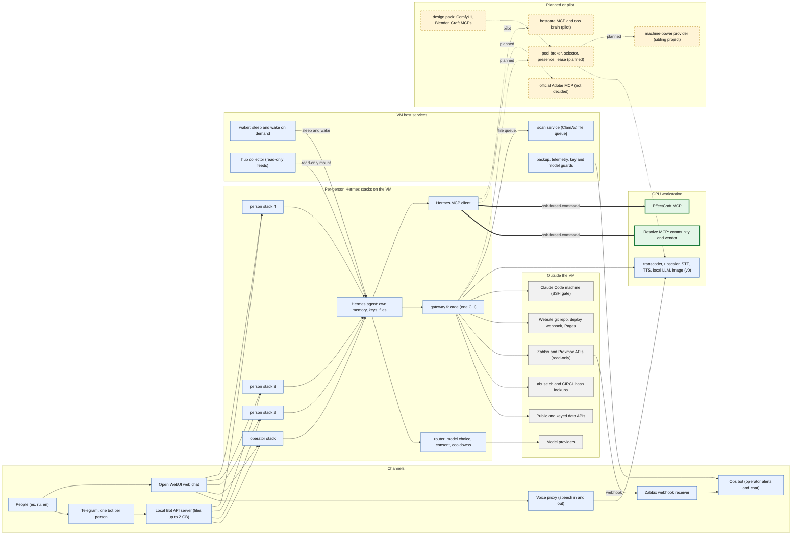
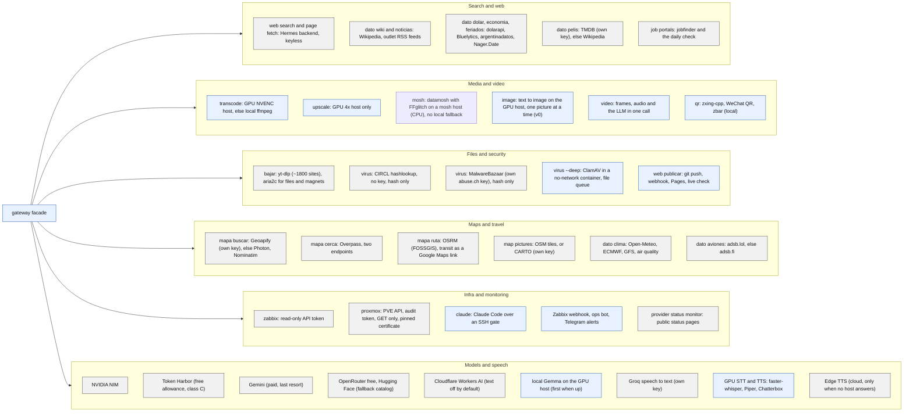
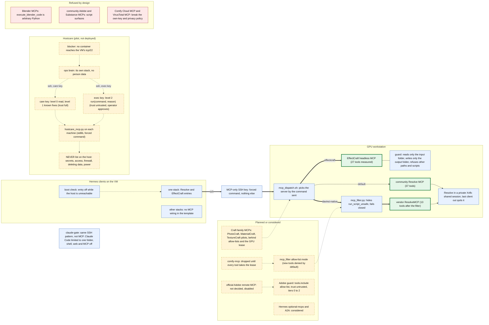

# Integrations map: APIs and MCP servers

This is a map of every API and MCP integration bridgeai already knows how to use, drawn from the code and docs in this repo.
It covers four views: the whole system, the APIs by purpose, the MCP servers with their guards, and what is only planned.
Planned or designed items are drawn dashed and labelled "planned"; nothing dashed is in production.
Names are generic on purpose: "the VM", "the GPU workstation", "the machine-power provider (sibling project)", and "the stacks" (one Hermes per person).
The inventory table at the end lists every integration with its kind, where it runs, who holds the key, its status and its source file.

## Legend

| Drawing | Meaning |
|---|---|
| Solid box and solid arrow | In production (or built and used on demand) |
| Dashed box and dashed arrow | Designed, planned or pilot only: not in production |
| Thick arrow | An MCP server behind a server-side guard (today a block-list filter or confined folders; an allow-list mode is planned) |
| Pale-blue box | Component of bridgeai or a service it runs |
| Grey box | Third-party service outside our control |
| Green box with a thick border | MCP server |
| Amber dashed box | Planned |

Privacy classes A, B and C (where a person's data may go) are defined in `DATA_LAW_AND_KEYS.md`.

Status words used below: "live" means the repo documents it as running; "on demand" means the GPU workstation services, which are kept stopped and started when needed; "pilot" means built and tested but not deployed.

## 1. Overview

## 2. API integrations by purpose

The `gateway` command is the single door from an agent to everything outside its container. Its verbs are grouped here by what they are for.
A key marked "own key" is the person's own free key, kept in that person's stack; the operator provides none (an optional key never blocks a verb:
each one falls back to a keyless source or says what is missing).

Notes for this view:
- `virus` sends only a SHA-256, and only for executables, installers, scripts and archives; a document or photo is never looked up.
  `--deep` never sends the file anywhere: a host service scans it in a container with no network.
- Two sources are fallbacks by design: `transcode` falls back to local ffmpeg (CPU) if no GPU host answers; `speak` falls back to Edge only when no TTS host answers.
  Speech never runs on the VM's CPU, and `upscale` has no CPU fallback.
- Cloudflare Workers AI is reserved for images (by policy): a text request goes there only if `ROUTER_CLOUDFLARE_TEXT=1` is set.
  Text to image runs as the image service on a GPU host; the broker, quotas and per-person binding are still a design (section 4).

## 3. MCP integrations and their guards

Every MCP server today runs on the GPU workstation and is reached over SSH with a key that can do one thing: the forced command. The Hermes boot
step disables an SSH-based MCP entry while its host is unreachable and re-enables it on a boot that finds the host up. Only one stack has this
wiring in the repo (the stack template passes no MCP host to the other stacks).

Notes for this view:
- The community Resolve server has no action that takes caller-supplied code, so it runs unfiltered. The vendor server has `run_script_unsafe`
  (full filesystem, network and subprocess access as the machine's user), which would be a shell behind the MCP-only key, so the filter removes it from
  `tools/list` and refuses a `tools/call` for it. The filter fails closed: batches, junk lines and non-string tool names never reach the server.
- The repo copy of `gpu-host/mcp_dispatch.sh` has the `effectcraft` case and a default case that starts the Resolve wrapper. The `davinci-native` route
  through the filter is described in `aibridge/VIDEO_TOOLS.md` and `aibridge/ops/resolve_host/README.md`; the live dispatcher on the workstation is not in this repo.
- Hostcare levels: 0 read and 1 known fixes need no approval, 2 asks the operator first, and "never" is enforced on the host even after approval.
  Client machines would get level 0 only.
- Token Harbor is not an MCP server: it is an OpenAI-compatible model provider (section 2).

### 3.1 A vendor's MCP server or our own gateway command

More vendors now offer a hosted MCP server next to their API. The vendor's MCP server is not always the better integration.
Often a `gateway` subcommand that calls the plain API is better. Decide with these questions, in this order:

1. **What leaves, and can we bound it?** A gateway command sends only what we cut (an excerpt, a re-encoded photo with no
   metadata, one field) and says so. An MCP tool takes whatever the model passes, and some take only a public URL, so the file
   would first have to be put on the internet.
2. **How much power does the connection carry?** Vendor MCP servers are built for an assistant managing an account. Their grants
   often include billing, payment links and token rotation next to the one useful call. A person's bot that anyone can message
   must hold only the one call it needs. That is a per-person API key used by one command.
3. **Whose key, and how is it stored?** Our rule is each person's own key, checked with a real call and kept in their stack's
   `.env` (the `SERVICES` table, `gateway servicios guardar`). An OAuth connector per person adds a browser flow, refresh tokens
   and a revocation story for every stack.
4. **What does the model see?** A gateway command prints fixed sentences, sanitises external text and keeps keys and content out
   of logs. An MCP tool returns the vendor's raw answer into the conversation. That answer is untrusted text that then travels
   to the cloud model.
5. **Does the vendor itself recommend the API for programmatic use?** Many do: their MCP server is for interactive use by a person
   in an assistant.

Use the vendor's MCP server when the work is interactive and broad (many tools, no fixed shape), it runs under the operator's own
account, and its tools can be filtered (section 3 guards). Write a gateway command when the job is one narrow call made on a person's
behalf.

| Vendor | Their MCP server | Our choice | Why |
|---|---|---|---|
| AudD (song recognition, 2026-11-09) | `https://mcp.audd.io`: OAuth 2.0 with PKCE; tools for API requests, docs, profile, usage, token get/rotate, plans, billing and Stripe payment links. Audio only by URL ("binary file upload is not possible through the tool"). | `gateway song FILE [--at S]` on the HTTP API with the person's own `api_token`. A 12 s excerpt (hard cap 15 s) is uploaded directly. | The audio would have to be published to reach the MCP tool. The grant carries billing and token rotation. AudD's docs recommend the direct API with `api_token` for programmatic recognition. The MCP server may still help the operator check usage from Claude Code. Not wired into any stack. |
| Comfy Cloud, VirusTotal | hosted MCP | refused (section 3) | Breaks the own-key and privacy rules. |

## 4. Planned and not built

Built today: host choice by expected finish time for media jobs (`ranked()` in `gateway.py`, each GPU service answers `GET /status`), and
`gateway maquina` for remote machines with credit (`MACHINES.md`). File exchange between agents of a pool and GPU job inputs/outputs through a small
S3 store is a design (`BLOB_STORAGE.md`).

Still design only, listed in the "Open design" section of `GPU_MEDIA_TOOLS.md`: a pool broker with per-stack quotas, a GPU lease and an operator busy
switch, host heartbeats, a warm worker with identity binding, Blender fixed-argv jobs, CAD from code, allow-listed Craft-family MCPs, and an optional
Adobe connector. Rules that shape those designs:
- AV1 is the only job class allowed a CPU path, always with an ETA the person sees. Images, 3D renders, upscaling, speech to text and text to speech never
  run on a CPU fallback; they fail clearly instead.
- Heartbeats are hints, not trust: each host has its own token, the privacy class of a host is fixed in the operator's config (never in the heartbeat),
  and a person's job never lands on a machine the person did not agree to.
- A person's photos and `.blend` files never leave the GPU host; a third-party connector may receive a file only with the person's own account and a yes for each file.
- Considered upstream and not adopted for now: A2A as a base for hostcare, the optional `comfy-cloud` MCP (rejected), upstream image and video plugin slots
  (to plug a design into later). See `HERMES_UPSTREAM_SCAN.md`.

## Free image APIs checked

Checked against official pages and the account's own model catalog (late 2026-11), so re-check before relying on any number:
- **Cloudflare Workers AI is the only viable free route.** Text-to-image models include `flux-1-schnell`, `flux-2-klein-4b`, `stable-diffusion-xl-lightning`; `flux-2-klein-4b` takes an input image. Free allowance: 10,000 Neurons a day, reset 00:00 UTC, no overage billing. It is shared by everything on the account, so keep a per-person daily budget in the gateway and send it no chat text. Enforcement is loose: the dashboard, not the router's own count, is the truth. Privacy class A (see `DATA_LAW_AND_KEYS.md`).
- **Not viable:** Gemini API image/video (no free tier found), Hugging Face Inference Providers (no free credits), NVIDIA's hosted catalog (no image models listed), consumer web apps with daily credits (no API to give a person).
- **Video:** no free API with a renewing allowance exists. Video runs on a local GPU host (`GPU_MEDIA_TOOLS.md`).
- **Choosing the best model per task** is measured the way `ops/model_scores.py` ranks text models: a fixed prompt set and a vision-model score, minus a cost term.

## Integration inventory

Auth values: "none" needs no key; "own key" is the person's own key, optional unless stated; "operator-owned" is a credential held by the operator for
operator infrastructure (never lent to a person).

| Integration | Kind | Where it runs | Auth | Status | Source file |
|---|---|---|---|---|---|
| NVIDIA NIM chat models | API | cloud, called by the router in each stack | own key | live | `aibridge/router.py`, `aibridge/ops/lib/providers.py` |
| Token Harbor (OpenAI-compatible, free allowance) | API | cloud, called by the router | own key (opt-in, privacy class C) | live | `aibridge/router.py`, `aibridge/ops/lib/providers.py` |
| Google Gemini (paid, last resort) | API | cloud, called by the router | own key | live | `aibridge/router.py`, `aibridge/ops/lib/providers.py` |
| OpenRouter free models | API | cloud, fallback catalog and menu probes | own key | live | `aibridge/ops/lib/providers.py`, `aibridge/ops/model_guard.py` |
| Hugging Face router | API | cloud, fallback catalog | own key | live (catalog entry; a key is optional) | `aibridge/ops/lib/providers.py` |
| Cloudflare Workers AI (text) | API | cloud, one stack only, explore candidates | operator-owned | live but off for text unless `ROUTER_CLOUDFLARE_TEXT=1` | `aibridge/router.py` |
| Cloudflare Workers AI (images) | API | cloud | operator-owned | planned (see "Free image APIs checked" below) | `aibridge/INTEGRATIONS_MAP.md` |
| Local Gemma 4 E4B (llama.cpp, OpenAI-compatible) | service | GPU workstation, port 8630 | none | on demand | `llm/Dockerfile`, `gpu-host/run_services.sh` |
| Local-first router with consent and cloud-direct switch | service | inside every stack container | n/a | live | `aibridge/router.py`, `aibridge/ops/gateways.json.example` |
| GPU transcoder (NVENC, closed option list) | service | GPU workstation, port 8610 | optional bearer token | on demand | `transcoder/server.py`, `aibridge/gateway.py` |
| GPU upscaler (4x) | service | GPU workstation, port 8600 | optional bearer token | on demand | `upscaler/server.py`, `aibridge/gateway.py` |
| Mosher (datamosh, FFglitch, CPU only) | service | any Docker machine (GPU workstation or the VM), port 8690 | bearer token (required) | on demand | `gpu-host/mosher/server.py`, `aibridge/gateway.py` (`cmd_mosh`) |
| GPU speech to text (faster-whisper) | service | GPU workstation, port 8620 | none | on demand | `stt/server.py`, `aibridge/gateway.py` |
| GPU text to speech (Piper, Chatterbox) | service | GPU workstation, ports 8640 and 8650 | none | on demand | `tts/server_piper.py`, `tts/server_chatterbox.py`, `gpu-host/run_services.sh` |
| Voice proxy (OpenAI-compatible STT and TTS) | service | per-stack container | none | live | `stt/proxy.py`, `aibridge/stacks/docker-compose.stack.yml` |
| Groq speech to text (voice notes fallback) | API | cloud | own key | live | `aibridge/gateway.py` (`cmd_transcribe`, `SERVICES`) |
| Edge TTS (cloud fallback) | CLI | inside the stack container | none | live | `aibridge/gateway.py` (`cmd_speak`) |
| Hermes web search and page fetch (Keenable backend) | API | cloud, Hermes tool | none | live | `aibridge/start_hermes.sh` |
| `gateway dato wiki` (Wikipedia) | API | cloud | none | live | `aibridge/gateway.py` |
| `gateway dato noticias` (outlet RSS feeds) | API | cloud | none | live | `aibridge/gateway.py` |
| `gateway dato dolar`, `economia` (dolarapi, Bluelytics, argentinadatos) | API | cloud | none | live | `aibridge/gateway.py` |
| `gateway dato feriados` (argentinadatos, Nager.Date) | API | cloud | none | live | `aibridge/gateway.py` |
| `gateway dato pelis` (TMDB) | API | cloud | own key (optional) | live | `aibridge/gateway.py` (`SERVICES`) |
| `gateway dato clima` (Open-Meteo, ECMWF and GFS side by side, air quality) | API | cloud | none | live | `aibridge/gateway.py` |
| `gateway dato aviones` (adsb.lol, adsb.fi) | API | cloud | none | live | `aibridge/gateway.py` |
| `gateway mapa buscar` (Geoapify, else Photon, Nominatim) | API | cloud | own key (optional) | live | `aibridge/gateway.py` (`SERVICES`) |
| `gateway mapa cerca` (Overpass) | API | cloud | none | live | `aibridge/gateway.py` |
| `gateway mapa ruta` (OSRM by FOSSGIS; transit as a Google Maps link) | API | cloud | none | live | `aibridge/gateway.py` |
| Map pictures (OSM tiles, or CARTO basemaps) | API | cloud | none, or own key for CARTO | live | `aibridge/gateway.py` |
| `gateway bajar` (yt-dlp, aria2c) | CLI | inside the stack container | none | live | `aibridge/gateway.py`, `aibridge/ops/yt-dlp.conf` |
| Subtitle backlog fetch | CLI | inside the stack container or hub | none | live | `aibridge/subs_fetch.py` |
| Job portals and the daily check | CLI | inside the stack container | none | live (notices are opt-in per person) | `aibridge/jobpush.py`, `aibridge/buscar-empleos.cjs` |
| `gateway qr` (zxing-cpp, WeChat QR, zbar) | CLI | inside the stack container | none | live | `aibridge/gateway.py` |
| `gateway video`, `bench`, `status`, `estado` | CLI | inside the stack container, call GPU hosts | none | live | `aibridge/gateway.py` |
| `gateway virus`: CIRCL hashlookup | API | cloud | none | live | `aibridge/gateway.py` |
| `gateway virus`: MalwareBazaar (abuse.ch) | API | cloud | own key (optional) | live | `aibridge/gateway.py`, `aibridge/skill_packs.json` |
| `gateway virus --deep`: ClamAV scan service | service (file queue) | VM host plus a throwaway no-network container | none | built, first run by the operator | `aibridge/ops/scan/scanner.py`, `aibridge/CAPABILITIES.md` |
| `gateway zabbix` | API | monitoring server | operator-owned read-only token per stack | live | `aibridge/gateway.py`, `aibridge/ops/ZABBIX.md` |
| `gateway proxmox` (PVE API, GET only, pinned certificate) | API | Proxmox hosts | operator-owned audit token | live | `aibridge/gateway.py`, `aibridge/SKILL_proxmox.md` |
| `gateway web` (git push, deploy webhook, Pages) | CLI | stack container, deploy key for one repo | own deploy key | live on one person stack | `aibridge/gateway.py`, `aibridge/SKILL_website.md` |
| `gateway claude` (claude-gate) | CLI over SSH forced command | a machine where Claude Code is logged in | own login on that machine | live | `aibridge/ops/install_claude_gate.sh`, `aibridge/ops/SKILL_claude_remote.md` |
| Telegram Bot API (one bot per person) | API | cloud, polled by Hermes | own bot token | live | `aibridge/start_hermes.sh`, `aibridge/ops/stack_telegram.py` |
| Local Telegram Bot API server (large files) | service | VM container | operator-owned app id | live where configured | `aibridge/docker-compose.yml`, `aibridge/patches/telegram_large_files.py` |
| Open WebUI web chat | service | per-stack container | per-person login | live | `aibridge/stacks/docker-compose.stack.yml`, `aibridge/ops/openwebui_setup.sh` |
| Ops bot (alerts and operator chat) | API | VM host | operator-owned bot | live | `aibridge/ops/opschat.py`, `aibridge/ops/lib/notify.py` |
| Zabbix webhook receiver | service | VM host | shared token header, operator-owned | live | `aibridge/ops/zabbix_hook.py`, `aibridge/ops/zabbix/provision.py` |
| Hub collector (feeds, read-only per person) | service | VM container run by a timer | none | live on one stack | `aibridge/hub/HUB.md`, `aibridge/hub/hub.py` |
| Waker (sleep and wake, RAM guard) | service | VM host | n/a | live | `aibridge/ops/wake/waker.py` |
| Backup, telemetry, key and model guards, provider status monitor | service | VM host timers | operator-owned | live | `aibridge/ops/backup-stacks.sh`, `aibridge/ops/telemetry.py`, `aibridge/ops/model_guard.py`, `aibridge/ops/provider_status.py` |
| MCP: DaVinci Resolve, community server | MCP | GPU workstation, over SSH | none (key restricted) | live on one stack | `gpu-host/mcp_dispatch.sh`, `aibridge/ops/resolve_host/README.md` |
| MCP: DaVinci Resolve, vendor server behind `mcp_filter.py` | MCP | GPU workstation, over SSH | none (key restricted) | live on one stack | `aibridge/ops/resolve_host/mcp_filter.py`, `aibridge/VIDEO_TOOLS.md` |
| MCP: EffectCraft headless | MCP | GPU workstation, over SSH | none (key restricted, confined folders) | live on one stack | `gpu-host/mcp_dispatch.sh`, `aibridge/SKILL_effectcraft.md` |
| MCP: hostcare (per machine) and the ops brain | MCP | each host over SSH; brain in its own stack | operator-owned keys | pilot (built and tested, blocked on the network path) | `aibridge/ops/hostcare/hostcare_mcp.py`, `aibridge/ops/hostcare/HOSTCARE.md` |
| `mcp_filter.py` allow-list mode | MCP guard | GPU workstation | n/a | planned | `aibridge/GPU_MEDIA_TOOLS.md` |
| Machine-power provider (sibling project): `gateway maquina`, `/machine` | API | the sibling project | the person's own account on the provider | live where configured | `aibridge/MACHINES.md`, `aibridge/gateway.py` |
| Image service (`gateway image`, text to image, SDXL-Lightning) | service | GPU host, port 8660, ComfyUI inside the container only | bearer token | live (one picture at a time, model unloaded after 60 s idle) | `gpu-host/imggen/server.py`, `aibridge/gateway.py` |
| Hermes upstream: A2A, optional-mcps, `tool_costs` and `spend_limit` | MCP and API | Hermes | n/a | considered | `aibridge/HERMES_UPSTREAM_SCAN.md` |
| Rejected: Blender MCPs, Comfy Cloud MCP, VirusTotal MCP, community Adobe and Substance MCPs | MCP | n/a | n/a | rejected | `aibridge/GPU_MEDIA_TOOLS.md`, `aibridge/HERMES_UPSTREAM_SCAN.md` |
