# Image pipeline

One path from a commit to every stack, run the same way each time by `ops/pipeline.sh`. Heavy work (builds, smoke tests,
parallel containers) runs on the operator's machine; the Docker host only loads a finished image and recreates stacks.

| Stage | Command | Where | Stops when |
|---|---|---|---|
| build | `ops/pipeline.sh build` | operator's machine (`ops/build_local.sh`, BuildKit state on an ext4 image in `BUILD_DIR`); pushed to the private registry, or a tar | the build or the push fails |
| smoke | `ops/pipeline.sh smoke [TAR]` | local staging Docker (`ops/staging_local.sh`) | a selftest fails, a check that passes on the baseline fails on the new image, or `router_smoke.py` fails inside it |
| guest | `AIBRIDGE_HOST=... ops/pipeline.sh guest [TAR]` | Docker host, guest `prueba` only | the load fails or the guest does not answer `/health` |
| canary | `AIBRIDGE_HOST=... ops/pipeline.sh canary TAR STACK` | Docker host, one real stack | the stack, the host's canary support, the disk, the backup (must list `state.db`) or the recreate fails |
| canary-undo | `AIBRIDGE_HOST=... ops/pipeline.sh canary-undo STACK [--restore]` | Docker host, that stack | no marker, a missing backup (`--restore`), or the recreate fails |
| deploy | `AIBRIDGE_HOST=... ops/pipeline.sh deploy [TAR] [stack ...] [--include-canary]` | Docker host, every stack except canaries | nothing is left once the canary stacks are skipped, the tar is not this commit's, origin does not have it, or `deploy_ops.sh` / `redeploy_router.sh` fails |

`ops/pipeline.sh all` runs build and smoke and prints the guest and deploy commands: those two touch the Docker host and
run only when the operator says so.

## The pipeline at a glance

Machines by role: the **build machine** (the operator's, with BuildKit, the private registry and the staging Docker), the **Docker
host** (every stack, the waker) and the **always-on VM** (each person's data, served to the Docker host over NFS; untouched by a
deploy). Arrows carry the protocol.

```mermaid
flowchart LR
  subgraph SRC["Source"]
    wt["working tree"] -->|"git push over SSH<br/>pre-push hook: privacy scan + every selftest"| gh[("public git origin, main")]
    gh --> cw["clean worktree of main<br/>(one per deploy)"]
  end
  subgraph BM["Build machine"]
    cw -->|"pipeline.sh build<br/>docker buildx bake (remote driver)"| bk["BuildKit container<br/>(cache on BUILD_DIR)"]
    bk -->|"HTTPS, own CA, basic auth: pusher<br/>only new layers"| reg[("private registry<br/>tag build-REV, digest file")]
    reg -->|"HTTPS pull by digest: puller"| stg["staging Docker-in-Docker"]
    stg --> sm{"smoke: selftests in the image,<br/>baseline compare, router_smoke<br/>(no network)"}
  end
  sm -->|"fails"| stop["stop: nothing reaches the host"]
  sm -->|"ok: pipeline.sh deploy"| ops
  subgraph DH["Docker host"]
    ops["deploy_ops.sh<br/>tar over SSH: ops scripts, user units"] --> pull
    pull["docker pull by digest over HTTPS (puller)<br/>tag latest + build-REV, keep prev- for rollback<br/>(fallback: tar over SSH, docker load)"] --> sched
    sched{"deploy_sched.py<br/>next recreate while load per CPU is under 0.75,<br/>RAM stays above the reserve, awake at most max_awake"}
    sched -->|"stack asleep"| rec["recreate_hermes.sh per stack<br/>flock recreate lock, docker compose up,<br/>HTTP /health, config + keys verify"]
    sched -->|"stack awake: skipped"| pend["update_pending note"]
    rec --> slp["waker: unused recreated brain<br/>goes back to sleep at once"]
    pend -->|"when idle (waker)"| rec
  end
  VM[("always-on VM<br/>persist, workdir")] -. "NFS (data only)" .- rec
  rec --> log["deploys.log: one phase line each,<br/>rc line with recreated / skipped / failed"]
  log --> cl["CHANGELOG.md entry<br/>(git push with the next change)"]
```

| Hop | Protocol | Auth | What moves |
|---|---|---|---|
| working tree → git origin | git over SSH | the operator's key; the pre-push hook blocks a privacy hit or a failing selftest | commits |
| BuildKit → registry | HTTPS (TLS with our CA) | basic auth, push account (password file, a throwaway client config) | only the layers the registry lacks |
| registry → staging, registry → Docker host | HTTPS, pull **by digest** | basic auth, pull account | the new layers; the digest is the integrity check |
| build machine → Docker host | SSH (`tar` stream, `scp`, remote commands) | the operator's key | ops scripts, units, files the Dockerfile copies |
| deploy → stacks | local Docker socket, `docker compose` | host user | containers recreated |
| recreate → stack | HTTP `/health` on the stack's bridge | none (host-local) | readiness |
| deploy ↔ waker | files in `ops/wake/` (`*.update_pending`, `*.booted_image`, `*.recreate.lock` with flock) | file permissions | who updates when, who may stop a brain |
| always-on VM → Docker host | NFS | export restricted to the host | each person's data (never touched by a deploy) |

## Details

- **TAR** is a build's file, by default the newest `.tar` or `.digest` in `BUILD_DIR/out` (see "Registry" below). Its name carries the commit (`aibridge-hermes-agent-<rev>.tar`, `-dirty`
  when built from uncommitted changes); the deploy stage refuses a `-dirty` tar and a tar that is not HEAD's.
- **Baseline** for the smoke comparison: `BASELINE=<image tag in staging>`, by default the build of the newest other tar, which
  is normally what production runs. Set it explicitly when several experimental tars exist.
- **Smoke checks** (`ops/image_smoke.sh`, one throwaway container, no network, no keys): OS and versions, ffmpeg encoders and
  AV1/x264 encodes, ImageMagick (text, resize, AVIF write), PDF create/read/raster, OCR in eng/spa/rus, QR (zbar and the
  `/opt/qrlibs` stack), pandoc with weasyprint, typst, the Python libraries the skills import, yt-dlp, network tools,
  no compiler in the runtime image, a headless Chromium screenshot and PDF, the Hermes CLI and, with `BLENDER_DIR`, a CPU
  Blender render. A check that fails on both images (today: ImageMagick reading PDF, which needs Ghostscript) is reported
  but does not stop the pipeline.
- **Guest stage**: the tar is loaded, `aibridge-hermes-agent:latest` is put back on the image it had (so no stack changes and
  the deploy's rollback tag stays right), and the guest is recreated on `aibridge-hermes-agent:build-<rev>` through
  `guests/prueba/image.override.yml`. A person then tries it: a normal chat, a document (PDF in and out), an image or video,
  a QR. The deploy stage removes the override and puts the guest back on `latest`.
- **Canary stage**: one real stack on a new image while every other stack and `latest` stay where they are (the guest stage's idea,
  on a person's data; use it for a change that needs real history, such as a Hermes upgrade). In order:
  1. Refusals before the stack is touched: bad name (`hernik` has no per-stack compose and cannot be a canary), an earlier canary of
     the stack, a Docker host whose `recreate_hermes.sh` / `waker.py` do not know canaries yet or whose waker started before its
     `waker.py` was updated (`CANARY_SKIP_WAKER_CHECK=1` skips only that last check), and too little disk (`MIN_FREE_GB` plus the
     size of the stack's persist dir).
  2. The tar is loaded (tag `aibridge-hermes-agent:build-<rev>`) and `latest` is put back on the image it had.
  3. The marker `ops/wake/<stack>.canary` (JSON: image, rev, time, backup path) and the override
     `stacks/<stack>/canary.override.yml` (the pinned image and `hostname: <stack>`) are written first, then the stack is stopped
     gracefully (it flushes its state), then its persist dir is tarred into
     `~/backups/keep/<stack>-pre-canary-<rev>-<date>.tar.gz` by a throwaway container (the files are root-owned); the archive is
     verified to list `state.db`, otherwise the stage aborts and removes marker and override.
  4. `ops/recreate_hermes.sh <stack>` recreates it on the override and waits for `/health`; the stage then checks image and
     hostname and prints the undo commands. A failed recreate keeps the marker (the stack stays pinned) and says how to retry or abandon.
  A fixed hostname matters because the v0.23.1 lease patch needs the same hostname across recreates.
  While the marker exists: the waker plans, announces and applies no update to `latest` for that stack and logs once that it is
  pinned (`updates.py`, `Stack.canary_pinned`); it only ever `docker start`s the existing container, which keeps its image across
  sleep and wake; `recreate_hermes.sh` adds the override to **every** recreate of the stack (a Telegram token change, the
  deploy, a manual run) and verifies the pinned image instead of `latest`; `redeploy_router.sh` refuses to touch a stack that has
  a marker.
- **Canary-undo**: stops the stack, removes marker and override, recreates it on `latest`. With `--restore` the backup is extracted
  first (checked before anything is stopped): the stack's persist dir is renamed `persist.canary-<time>` (root-owned, kept for
  you to inspect or delete) and the pre-canary archive becomes the new `persist`. Without it the data the canary wrote is kept,
  which a newer Hermes may have migrated: restore when going back to an older image.
- **Deploy stage**: `ops/deploy_ops.sh --apply` (ops files and user units), then `ops/redeploy_router.sh` with `IMAGE_DIGEST` (a pushed
  build; its tar, when there is one, as `IMAGE_TAR` for the fallback) or `IMAGE_TAR`:
  every sleeping stack is recreated and verified; an awake one gets `ops/wake/<name>.update_pending` and the waker applies it
  when the stack is idle (exit code 3 means some were left to the waker). Restart the waker only when `deploy_ops.sh` says
  its unit or code changed, and never while an update is running.
- **Changelog**: when the deploy went through (exit 0 or 3), the stage records the build. `ops/changelog.py add` puts an entry at the top
  of `aibridge/CHANGELOG.md` (the commit subjects since the revision it replaced, the image id, a note when some stacks were left to
  the waker); `ops/changelog.py show [N]` prints the newest entries. The file is left changed in the tree: commit it with the next
  change (the next `deploy` refuses a dirty tree until then). One more line per deploy goes to the private `BUILD_DIR/out/deploys.log`
  (time, revision, replaced revision, image, host, the stacks still pending): per-stack and host details never go in the repo.

## Registry

The build goes to a private registry instead of a 2.4 GB tar: BuildKit pushes only the layers the registry lacks, and the hosts pull only
the layers they lack. Measured on 2026-11-27 for a change to one text file the image copies: build 15 s with the push (1.5 s of it) against
23 s with the tar export (10.8 s of it); the Docker host's pull 4.0 s (the tar path sent and loaded all 2.4 GB); staging's pull 7.3 s against
17.5 s for loading the tar.

- **Settings** (never in git): `REGISTRY=host:port` and, when they differ from the defaults, `REGISTRY_CA`, `REGISTRY_PUSH_USER`,
  `REGISTRY_PUSH_PASS_FILE`, `REGISTRY_PULL_USER`, `REGISTRY_PULL_PASS_FILE`, `IMAGE_DELIVERY`, from the environment or the untracked
  `BUILD_DIR/pipeline.env` (KEY=VALUE lines, read, not run; `AIBRIDGE_HOST` may live there too). `ops/lib/pipeline_env.sh` has the
  defaults (the CA and password files under `BUILD_DIR/registry/`). Passwords are read from their files into a throwaway client
  config for the one command that needs them; they are never printed, never in argv and never left in `~/.docker`.
- **Modes** (`IMAGE_DELIVERY`): `registry` (the default once `REGISTRY` is set) writes `BUILD_DIR/out/aibridge-hermes-agent-<rev>.digest`
  (the pushed image's `sha256:` digest, tag `<registry>/aibridge-hermes-agent:build-<rev>`); `tar` is the old docker-archive export,
  kept as the fallback for a few weeks; `both` does the two. Without `REGISTRY` everything works as before.
- **By digest**: the registry has no per-account rights, so the hosts never trust a tag: the deploy, guest and canary stages pull
  `<registry>/aibridge-hermes-agent@sha256:<digest>` (Docker checks every layer against it), name it (`latest` and `build-<rev>` on deploy,
  only `build-<rev>` for guest and canary) and drop the digest name. The image stays local: a wake never needs the registry, which lives
  on the operator's machine and is not always on.
- **Fallback**: a pull that fails puts `latest` back and uses the tar of the same revision when there is one, saying so in capitals
  (`REGISTRY PULL FAILED ... falling back to the tar`); with no tar nothing is recreated and the message says to check the registry or
  rebuild with `IMAGE_DELIVERY=tar`. Smoke falls back the same way.
- **BuildKit** verifies the registry with its CA through `BUILD_DIR/buildkitd.toml` (written by `build_local.sh`). The BuildKit container
  reads it at start, so `build_local.sh` recreates it once when it was started without it (its cache is in the ext4 image and stays);
  builds hold `BUILD_DIR/buildkit.lock` shared, the recreate needs it exclusive, so it never happens under a running build.
- **One-time setup of a host** that pulls: the CA in `/etc/docker/certs.d/<registry>/ca.crt` and
  `docker login <registry> -u <read account> --password-stdin < <its password file>`. Staging gets both per pull (`staging_local.sh pull`).
- **Retention**: the registry keeps every pushed build. Delete old manifests by digest (the registry runs with deletes enabled) and
  run its garbage collection now and then; not automated yet.

## Parallel recreates

`redeploy_router.sh` hands the stack list to `ops/deploy_sched.py`, which runs `ops/recreate_hermes.sh <stack>` for as many stacks at once
as the Docker host can take. The next one starts when the 1-minute load per CPU is under `DEPLOY_LOAD_PER_CPU` (0.75), MemAvailable minus
what the recreates in flight still have to take minus this stack's need stays at or above the waker's `reserve_mb`, and the awake
on-demand brains (people's + recreates in flight; always-on brains do not count, as in the waker) stay within the waker's `max_awake`
(both read from the host's `ops/wake/stacks.json`). A stack's need is its largest brain `peak_mb` in the host's telemetry
(`~/.local/state/telemetry.db`, 14 days), never below its `est_brain_mb`, `DEPLOY_DEFAULT_NEED_MB` (1000) without a row. Starts are at
least `DEPLOY_LAUNCH_GAP_S` (10) apart so the load and memory show the previous boot; with nothing in flight one starts anyway (the deploy
always moves on). `DEPLOY_MAX_INFLIGHT=1` gives the old one-by-one order. A failed recreate never stops the others: each stack's lines are
printed (prefixed with its name) when it ends, then a table of every stack's result. The skip of awake stacks and their
`update_pending` notes are unchanged; `redeploy_router.sh` exits 1 when any recreate failed, else 3 when any stack was left to the waker.

A recreated stack nobody used goes back to sleep at the waker's first tick after `recreate_hermes.sh` released its lock and nothing runs
in it (`waker.py`, `sleep_after_recreate`); before, the boot counted as activity and the idle rule kept it up ~10 minutes. The scheduler
times that stop (up to `DEPLOY_STOP_WAIT_S`, 150 s; a waker that was not restarted after `deploy_ops.sh` keeps the old behaviour and the
stack is reported "still up"). Always-on and warm stacks stay up as before.

## Deploy log

`BUILD_DIR/out/deploys.log` gets, per deploy: a `deploy-start` line, one `phase` line per phase (`build`, `export`, `push` or `tar` from
the build's own `BUILD_DIR/out/<name>.phases`, `smoke`, `deploy_ops`, `selftests`, `ship`, `pull` or `load`, `prune`, per stack
`recreate` (result ok / awake / failed), `health` and `stop`, `recreates` (wall time), `guest`, `total`), then the end: the classic
`<iso> rev=... prev=... image=... host=... rc=...` line for a deploy that went through, with `delivery`, `recreated`, `skipped_awake`,
`failed`, `results` (stack:result) and `total_s` added before `pending=` (still the rest of the line), or a `deploy-end` line for one
that did not. New lines never carry a `rev=` key, so a reader of the classic lines sees what it saw before. The counts are what the deploy
itself did; `pending=` stays the notes left on the host at the end. `python3 ops/deploy_log.py show [N]` prints the last deploys with
their phases (it reads the older line shapes too).

## Rules

- Commit before building what you mean to deploy; push before the deploy stage.
- No redeploy while other work is editing the tree: `redeploy_router.sh` ships the working tree's files.
- When the main checkout holds someone else's uncommitted work, build, push and deploy from a clean worktree of main
  (`git worktree add ../bridgeai-wt-deploy main`); `ops/run_selftests.sh` drops git's hook variables, so the pre-push
  hook is safe there.
- Staging never holds live keys or a live Telegram token, and its crons stay off.
- Keep at least 25 GB free on the Docker host (`redeploy_router.sh` checks, and prunes every `build-*` tag that is not
  latest plus all but the newest two `prev-*` rollback tags).
  `MIN_FREE_GB` (default 25) sets that limit for the pipeline's guest and canary stages and for `redeploy_router.sh`. It can be lowered
  for a deploy when the new image shares almost all its layers with the running one, because then it adds little disk. Lower it
  only after checking that; a base rebuild writes about 10 GB of new layers.
- The deploy stage always puts guest `prueba` back on latest.
- A canary needs the canary-aware `recreate_hermes.sh` and `waker.py` on the host first: commit, `ops/deploy_ops.sh --apply`, restart
  the waker (when no stack is waking), then run the canary. `deploy` does not refuse while a canary exists: it deploys to every stack
  except the canary stacks (the stacks named after the tar, else every stack in the host's `ops/wake/stacks.json`, minus the canaries) and
  prints one line per skipped canary, `<stack>: canary on <image>, left pinned; end it with ops/pipeline.sh canary-undo <stack> [--restore]`.
  The canaries stay on their test build; `latest` moves as usual and the guest follows it. It exits 1 when no stack is left. Only
  `deploy --include-canary` ends every canary marker on the host (marker and override removed, also for stacks that are not in the deploy list), after its other checks and `deploy_ops.sh` have passed and
  right before `redeploy_router.sh`, which then gets the original stack list (the pre-canary backup stays in `~/backups/keep`).
  `redeploy_router.sh` itself still refuses a stack with a marker.
- A tar must be rebuilt after committing (`<rev>` is the commit it was built from) before it is used for a canary or a deploy.
