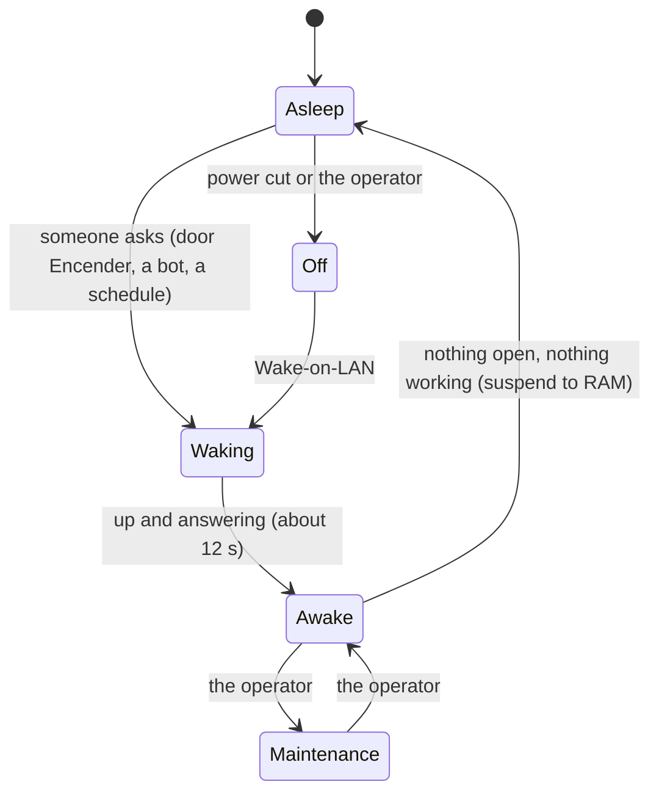

# States of the machines, the places and the bots, and how games are shared

One page with every state a person or the operator can see. The door, the LAN overview (`../overview/`) and the bot's `/estado` all speak this
vocabulary. Built pieces are marked; the rest is the design in `PLACES.md` ("When the person is away").

## The GPU host (and any machine the wake service knows)

| State | What it means | Who sees it | Built |
|---|---|---|---|
| Awake | Up; its places and gate answer | door load panel, overview, `/estado` | yes |
| Asleep | Suspended to RAM; wakes in seconds; frozen places survive it | door ("la máquina descansa"), overview | yes |
| Waking | Wake-on-LAN sent, waiting for the gate | door ("Listo en unos N s") | yes |
| Off | No power or shut down; frozen places are lost | overview (does not answer) | yes |
| Maintenance | Nobody can open or enter a place; the door shows a maintenance page | door (503 page), overview | yes (the door's maintenance flag) |
| Rush hour | The operator's switch: no automatic close, freeze or priority change | overview | no |

The host sleeps when every place is off or frozen and nothing else runs (`gpu-host-sleep`; a paused container must count as asleep, to build).

## A desktop place

```mermaid
stateDiagram-v2
    [*] --> Off
    Off --> Starting: Encender (door), escritorio abrir (bot)
    Starting --> InUse: somebody watching and touching, playing or with sound
    InUse --> Unwatched: nobody watching, or watching without touching
    Unwatched --> InUse: back
    Unwatched --> Warned: 10, 5, 1 min before the close
    Warned --> InUse: back
    Warned --> Off: idle close (30 min; 10 min for a game nobody watches)
    Warned --> KeepWorking: the person chose it at the first notice
    Warned --> Frozen: the person chose it, memory allowing
    KeepWorking --> Off: the task ends or 3 hours pass
    Frozen --> InUse: Encender (instant)
    Frozen --> Off: memory needed by others, power cut (the person is told the state was lost)
    InUse --> Off: Apagar
    Off --> Restoring: a snapshot is restored (the operator, later the person)
    Restoring --> Off
```

| State | CPU | RAM | Disk writes | Built |
|---|---|---|---|---|
| Off | none | none | none | yes |
| Starting | | | | yes (the door's estimate) |
| In use (human activity) | weight 1024; 4096 with a game | used | as used | yes |
| Unwatched | weight 256 | used | | yes |
| Warned | | | | yes (desktop + the person's bot) |
| Keep working | lowest priority (`cpu.idle`) | kept | what the task writes | no |
| Frozen (`docker pause`) | none | kept | none | no |
| Restoring | | | | yes (`place.py restore`, the gate refuses to open it meanwhile) |

"Human activity" is: a web connection or a Moonlight client, AND a touch in the last 90 s, an open game, or sound playing. A render with nobody
watching and no game also keeps a place open. Every state is per place; the person never sees another person's state, only counts.

## A bot stack (Hermes)

| State | What it means | Built |
|---|---|---|
| Asleep | Container stopped; a message wakes it (the waker holds it and replays it) | yes |
| Starting | Booting after a wake | yes |
| Awake | Up; may be warm (kept up) or always-on | yes |
| In a turn | Answering the person right now: never stopped or recreated | yes |
| Update pending | A new image is waiting; the waker applies it when idle, after a short notice | yes |
| Frozen / keep working | The same three away states as places, for containers without a GPU | no |

## Game servers

| State | What it means | Built |
|---|---|---|
| Up, empty | Answers; nobody playing | yes (door "Jugando ahora", overview) |
| Up, with players | Map, players, score, ping (Quake III `getstatus`); bots shown apart | yes |
| Down | Does not answer | yes |
| Each game its own | One server container per game, named in its `games/` profile | design |

## How games are shared

The rules, in order of what matters:

1. **Each person plays with their own account and their own copy.** Their own key, their own purchase. Saves, settings, Proton prefixes (`compatdata`),
   shader caches and `userdata` are never shared.
2. **Each place keeps its own normal Steam (or Heroic) library**, with its own manifests and its own updates. Steam never sees anything unusual.
3. **Identical large files are stored once.** A dedupe job, run from the "before standby" task queue, joins files of 1 MB and up that are
   byte-identical between the places' libraries.
   - Inside the `library` subvolume it hardlinks them: one copy on disk and one in memory, so two places running the same game read its data
     once.
   - btrfs cannot hardlink across subvolumes. A library inside a place's home is joined with reflinks instead (the kernel's dedupe call, as
     `duperemove` does): one copy on disk, but separate in memory, and a write makes a new copy for the writer only.
   - So games go to `library`, and libraries still inside a home move there over time.
   - Small files stay each place's own.
4. **All libraries and homes live on one btrfs disk** (the NVMe partition formatted on 2026-11-26).
   - Each place's home is a subvolume, with snapshots kept 7 days.
   - The extra libraries sit in the `library` subvolume.
   - The migration turned hardlinks between a place's home and its extra library into separate copies (one games place: about 30,000 files);
     the dedupe job takes that space back.
5. **Updates.** When one place updates a game, Steam writes new files, so that place's changed files stop being shared. The next dedupe run
   re-links them once the other places have the same version.
6. **Uninstall.** Through Steam's own uninstall, never by deleting files.
   - Uninstalling drops only that place's links; the others keep their copy, and the last one to uninstall frees the space.
   - A game marked shared (the weekly game) cannot be uninstalled from a place.
7. **The weekly co-op game** (`WEEKLY_COOP.md`) is installed once, hardlinked into the library of every person who owns it, and kept read-only for
   the places.
8. **Not shared:** anything a game writes at run time into its own install folder. Such files are excluded by name in the game's profile.

One place on more than one GPU host (the person's data synced from the copy used last, games installed per host only where the hardware meets
their needs, GPU caches local and never backed up): `MULTI_HOST.md`.

What exists today:
- **Built:** the btrfs disk, the per-place subvolumes, the snapshot commands and the migration.
- **Next:** the dedupe job, the shared marking in the game profiles, and the uninstall verb for the bot.
